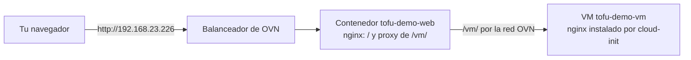

# incus-instancias

Ejemplo de lo más común en Incus, en la red OVN `ovn-lan`, con algo que se valida desde el navegador:



| Recurso | Qué es | Dónde |
|---|---|---|
| `incus_instance.vm` | VM `images:debian/13/cloud` (1 CPU, 1 GiB). Su **cloud-init** instala nginx y genera una página con datos de la VM | `eve` |
| `incus_instance.web` | Contenedor de aplicación `docker:nginx:1.29-alpine`: su propia página en `/` y **proxy** de `/vm/` hacia la VM | `invincible` |
| `incus_network_lb.web` | Balanceador de OVN: publica el puerto 80 del contenedor en `192.168.23.226` | red `ovn-lan` |

`ovn-lan` está aislada a propósito (NAT, sin ruta desde la LAN): desde la LAN solo se llega por el balanceador. Las dos
instancias quedan registradas solas en el DNS (zona `ovn.homelab.local` de Incus, con sus IPs internas).

Las dos instancias usan los perfiles `default` y **`ovn-lan`**. Ese perfil pone la NIC en la red OVN y le fija el MTU,
y lo crea Ansible (ver abajo). Tiene que existir antes del `apply`.

## Archivos

| Archivo | Qué es |
|---|---|
| `instancias.tf` | Las dos instancias y el balanceador |
| `plantillas/vm-cloud-init.yaml` | user-data de la VM: instala nginx y genera su página (`templatefile`) |
| `plantillas/web-index.html`, `plantillas/web-nginx.conf` | Página y config del nginx del contenedor; la IP de la VM se completa al aplicar |

## Probar

```bash
cd opentofu/incus-instancias
tofu init
tofu apply -parallelism=1        # con SSO; ~60 s con las imágenes ya bajadas
tofu output                      # url, IPs internas y nombres DNS
```

Abre `http://192.168.23.226`: la página del contenedor, con un enlace a **Ver la VM** (`/vm/`), que muestra la página
que generó cloud-init dentro de la VM (su nombre, kernel, versión de nginx —1.26, la de Debian, distinta de la 1.29
del contenedor— y la hora de la instalación). Desde la consola:

```bash
curl -s http://192.168.23.226/ | grep -o 'Hola desde el contenedor'
curl -s http://192.168.23.226/vm/ | grep -o 'Hola desde la VM'
tofu destroy -parallelism=1
```

Probado el 18 nov 2026: tres ciclos seguidos de `apply` y `destroy` desde cero (58–68 s cada `apply` con las imágenes
en caché), con `/` y `/vm/` respondiendo en cada uno. Con el perfil `ovn-lan`, un ciclo más desde cero (2 min 44 s,
bajando las imágenes): las dos instancias con MTU 1442.

## Por qué hay `exec` si ya hay user-data

El user-data hace todo el trabajo (instalar y configurar); los dos `exec` solo ordenan los tiempos:

- **VM, `cloud-init status --wait`**: cloud-init corre por su cuenta dentro de la VM después de arrancar. Sin esperar,
  el `apply` termina en unos 30 s, mientras `apt` todavía instala nginx, y `/vm/` responde 502 un par de minutos. Con
  la espera, cuando `apply` dice "complete" la página ya funciona, y si cloud-init falla, el `apply` falla con él.
- **Contenedor, `nginx -s reload`**: nginx arranca antes de que OpenTofu copie `default.conf`. Sin recargar, sigue con
  la config original y `/vm/` responde 404 (la página de `/` sí cambia, porque nginx lee los archivos en cada pedido).

## El perfil `ovn-lan` y el MTU

`ovn-lan` tiene MTU 1442 (el túnel de OVN usa parte de cada paquete). Su DHCP lo anuncia, pero `systemd-networkd` en
la VM no lo aplica por defecto y la deja en 1500: los paquetes grandes se pierden y `apt` falla con
`Connection timed out` en las descargas (los archivos chicos sí bajan). El perfil `ovn-lan` trae un
`cloud-init.network-config` que le pide usar el MTU del DHCP. Por eso el user-data de este ejemplo solo instala nginx,
sin ocuparse de la red. El porqué completo y cómo crear el perfil
(`playbook-incus-cluster.yml --tags ovn-profile`) están en
[Instancias en `ovn-lan`](https://homelab.maceo.cl/incus/cluster-setup/#instancias-en-ovn-lan-el-perfil-y-el-mtu).

Si una instancia define su propio `cloud-init.network-config`, reemplaza el del perfil. Esa config tiene que nombrar la
interfaz tal cual (`enp5s0`): con `match: name: "en*"` cloud-init genera una config que no coincide con ninguna
interfaz y la VM queda sin red.

## Variables

| Variable | Default | Uso |
|---|---|---|
| `prefix` | `tofu-demo` | Prefijo de los nombres de las instancias |
| `profile` | `ovn-lan` | Perfil de las instancias (NIC en la red OVN y MTU) |
| `network` | `ovn-lan` | Red del balanceador: la misma del perfil |
| `web_target` / `vm_target` | `invincible` / `eve` | Miembro del clúster de cada una (la VM necesita un nodo x86) |
| `lb_address` | `192.168.23.226` | IP del balanceador: libre dentro de `192.168.23.224/28` (`192.168.23.225` ya la usa otro balanceador) |

Para dos copias a la vez, cambia `prefix` y `lb_address` (`-var prefix=otro -var lb_address=192.168.23.227`), cada
una en su propia carpeta o workspace (`tofu workspace new otro`). La primera vez Incus baja las imágenes (nginx y
Debian 13 cloud) y quedan en su caché.

## Si falla

| Síntoma | Causa |
|---|---|
| `Failed to execute command "esperar-cloud-init"` | cloud-init terminó con error: `incus exec homelab:tofu-demo-vm -- cloud-init status --long` y `/var/log/cloud-init-output.log` |
| `Profile not found` | Falta el perfil `ovn-lan`: `playbook-incus-cluster.yml --tags ovn-profile` (ver arriba) |
| `apt` con `Connection timed out` en la VM | La VM quedó en MTU 1500: no tiene el perfil `ovn-lan`, o un `cloud-init.network-config` propio lo reemplaza |
| `/vm/` responde 404 | El nginx del contenedor no recargó la config (falta el `exec` de recarga) |
| `/vm/` responde 502 | nginx de la VM todavía no está (sin la espera de cloud-init) o la VM no tiene IP |
